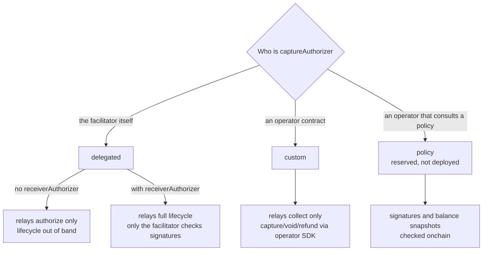
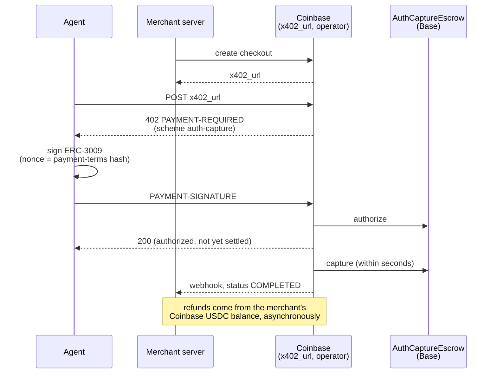

## Abstract

x402 was pitched in its 2025 whitepaper as irreversible by design: "No chargebacks, no fraud risks, no intermediaries"[^s01]. That suits a per-call API fee. It fails an agent buying goods on a person's behalf, and x402's response is the `auth-capture` scheme, which layers refundability onto the Commerce Payments Protocol (CPP) escrow that Coinbase and Shopify deployed on Base[^s02][^s22]. This report reads both repositories and the official documentation, and it measures a week of the escrows' events on Base mainnet. The lower layer holds up. CPP carries six audits, all 115 tests in its v1.1.0 suite pass locally, and the signature nonce computed by the x402 Go SDK matches the live escrow's `getHash` byte for byte[^s04]. In a month the upper layer grew to v1.1, with two payment flows and two operator types, plus a third that is reserved. The spec itself calls the protection on its default, facilitator-as-operator path "trust, not proof"[^s03]. The server and facilitator SDKs merged in early October, yet as of 23 October no release contains them and no public facilitator advertises the scheme[^s08][^s09][^s10][^s13]. Real use sits elsewhere. Coinbase Business checkouts already take agent payments over auth-capture, with Coinbase capturing within seconds[^s14][^s15]. On chain, the v1.0 escrow moved about 1.7 million USDC in seven days, one operator handled 89% of it, and the median time from authorization to capture was four seconds[^s24]. In practice the escrow mostly serves as a reversible instant payment, and holds that last until delivery are the exception. ACP and AP2 leave refunds and disputes to PSPs or to an audit trail[^s17][^s19]; auth-capture puts the reversal in a contract, and that is the part of agentic commerce x402 can claim.

## 1. Introduction

The x402 whitepaper, dated May 2025, promised settlement "in ∼200ms" with "No rolling chargeback windows". Its comparison table marks x402's chargeback risk as "No - not reversible"[^s01]. For a seller charging cents per request, finality is the product.

A shopping agent needs the opposite. A September 2026 arXiv paper puts it plainly: x402's model is "atomic and final", which "suits metered access and fails commerce", because a purchase made for a person "is large, frequently cancelled, and should not become the seller money until delivery"[^s22]. The x402 repository's own spec frames `auth-capture` the same way. Where `exact` "moves a fixed amount once and offers no way to give it back", auth-capture covers payments whose final amount is unknown at authorization "or which may later need to be undone"[^s02].

This site covered [the same two repositories](../../x402-auth-capture-commerce-payments/en/) on 22 September 2026, when x402 shipped only a client and the docs did not list the scheme. This report follows the month since. It asks three things. Do the contracts and the SDK actually agree? What has shipped? And how is the escrow used on chain?

## 2. The lower layer: Commerce Payments Protocol

### 2.1 Designed so the operator need not be trusted

Coinbase and Shopify announced CPP on 12 June 2025. It brings the card-network two-step on chain, "first locking buyer funds (authorize), then disbursing them to the merchant (capture)". It also introduces "a new role called an operator" to move funds between the parties[^s06]. Shopify's motivating case is split shipments: "Captures can be made in multiple partial increments to support merchants that may fulfill goods in multiple deliveries"[^s07].

The security write-up is candid about the operator's limits. An operator "cannot steal funds from the protocol". However, it can "censor payments by failing to move a payment through its lifecycle or by prematurely voiding payments". At worst it can "siphon the maximum configurable fee rate to an address of their choosing"[^s05]. Escrowed funds are split across per-operator `TokenStore` contracts at addresses derived from each operator. A bug in the singleton escrow therefore cannot drain other operators' liquidity. The document also concedes that a USDC-denylisted receiver or fee receiver can leave an authorized payment uncapturable[^s05].

### 2.2 Audits, and re-running the tests

The previous report could not settle whether CPP had five audits or six. The README's audit table and the files in `audits/` agree on six. Coinbase Protocol Security ran three in March and April 2025, and Spearbit ran two in April 2025. The sixth is a Spearbit review of the v1.1.0 rounding and billing change, dated 22 July 2026[^s04].

At the v1.1.0 commit (`b748fdd`), `forge test` passes 112 of 113. The one failure is a missing Base fork RPC variable. Pointing that suite at a public RPC makes its three fork tests pass as well; they cover Coinbase Smart Wallet over ERC-3009, spend permissions, and a plain EOA[^s04]. A green suite proves only what the suite checks, and no more is claimed here.

### 2.3 Do the SDK and the contract hash the same thing?

auth-capture rests on putting a hash of the whole payment into the client's ERC-3009 nonce. The spec defines that nonce as `keccak256(abi.encode(chainId, escrow, payer-zeroed PaymentInfo hash))`[^s03]. That is exactly what the escrow's `getHash` returns when given a zero payer, so a fixed fixture was run three ways. The first was the x402 Go SDK's `ComputePayerAgnosticPaymentInfoHash`. The second was an `eth_call` to `getHash` on the live v1.1 escrow, and the third was the salt binding recomputed with `cast` straight from the spec formula. All three agreed, and so did the real-payer `paymentInfoHash`[^s03][^s04]. The design claims that one signature commits to operator, receiver, deadlines, fee range and salt. For this pair of implementations, the claim holds.

## 3. The upper layer: auth-capture v1.1

### 3.1 Two flows, two deadlines

v1.1 picks a lifecycle with `extra.paymentFlow`. The default, `escrow`, places a hold with `authorize` before the resource runs, then `capture` or `void` afterwards, and `refund` later still. `authorization` settles with a single `charge` after the resource runs, so there is no hold and no `capture`, `void` or `reclaim`[^s02]. Later operations ride the existing `/settle` call, named by `payload.type`, with "no new facilitator endpoint"[^s02]. The EVM binding adds `captureMode` (`sync` or `deferred`) and removes v1.0's `autoCapture`, which the TypeScript SDK now rejects outright[^s03][^s08].

What protects the buyer is two timestamps. `captureDeadline` is the last moment to capture and the moment `reclaim` opens to the payer. `refundDeadline` closes refunds[^s02]. The spec's promise is that "a resource server that abandons a payment cannot strand it forever"[^s02]. Until the first deadline passes, though, the buyer has no way out alone.

### 3.2 Operator types choose where the trust sits

The headline addition is `extra.operatorType`. The escrow accepts exactly one `msg.sender` per payment, the `captureAuthorizer` committed as `PaymentInfo.operator`. Who holds that address decides the rest[^s03].

_Figure 1 — Operator types in the auth-capture v1.1 EVM binding. Moving down, less is entrusted to the facilitator and more happens outside the protocol. `policy` exists only in the spec's appendix.[^s03]_

Under `delegated` with a receiver authorizer, the facilitator relays capture, void and refund. The spec says plainly what the server gives up. "nothing onchain requires an authorizer signature", so "the facilitator's own verification is the only gate". Within the client-signed ceiling, the fee bounds and post-deadline `reclaim`, "it is trust, not proof"[^s03]. Fees follow the same logic. A delegated server is exposed to `maxFeeBps` whatever it signs, so the spec recommends a fixed fee (`minFeeBps == maxFeeBps`). It warns that "publishing a range is granting the discretion, not reserving it"[^s03].

`custom` sits at the other end. The facilitator relays one collect call and nothing more. Time locks, freeze windows and arbitration are the operator contract's business, and the facilitator neither relays nor validates them[^s03]. The facilitator is now calling into code it has not reviewed, so it must cap the gas itself. It must also assert in simulation that the expected escrow event, state transition and token movements actually occurred. A call that merely did not revert is not enough[^s03].

`policy` is meant to close the gap. An operator contract verifies the authorizer's signature and the balance snapshot on chain, and it consults a separate policy contract through read-only hooks. Because the policy address is folded into the salt, a payer "knows which rules govern its money before it pays"[^s03]. For now the value is only reserved. The appendix's Solidity "illustrates a future addition rather than audited or deployed code"[^s03].

### 3.3 Single use without a nonce, and who funds refunds

Capture and refund repeat, so a server's consent signature must not be replayable. v1.1 keeps no nonce store. Instead, each signature binds the expected `(capturableAmount, refundableAmount)` pair, and the facilitator compares it with `paymentState` on chain. Once a refund lowers the sum it never recovers, so the pair cannot recur: "the payment's own state is the replay key"[^s03]. Under `delegated` this check happens only at the facilitator, and state can move between check and inclusion. The spec calls the guarantee "best-effort"[^s03].

Refunds are structurally awkward. The refund collector pulls tokens from `PaymentInfo.operator`, and under `delegated` that address is the facilitator's. The facilitator would become the source of value, so the spec requires it to refuse delegated refunds unless it has an out-of-band funding agreement with the receiver. A server that delegates both operator and authorizer is "captive to this facilitator until its refundDeadline"[^s03].

## 4. What has actually shipped

### 4.1 Merged but unreleased

The Go server and facilitator merged on 5 October 2026 (PR #3622) and the TypeScript v1.1 SDK on 6 October (PR #3203)[^s08][^s09]. On 23 October, npm's latest `@x402/evm` is still 2.28.0, published 29 September. Its tarball contains `auth-capture/client` and nothing else. No release tag contains either merge commit, and the Go changelog entries still sit under `unreleased`[^s09][^s10]. Built from main, the four Go auth-capture packages (root, client, facilitator, server) pass their tests. The code runs; it simply has not been published.

The docs are a step ahead. The scheme overview now lists auth-capture as the fourth scheme, "for refundable payments where funds are held in escrow and released". The SDK feature table ticks TypeScript and Go and leaves Python unticked[^s11][^s12]. That table does not break support down by role. A reader who takes it at its word and installs from npm will find no server code in the package.

The facilitator side is empty too. Fetched on 23 October, the public `/supported` lists show exact, upto and batch-settlement at x402.org. PayAI lists exact and batch-settlement, and x402.rs lists exact and upto. Coinbase's CDP facilitator requires authentication and was not checked[^s13] _(unverified — single source)_.

### 4.2 Coinbase Business already runs it

While the open-source path is still unpublished, the production user of auth-capture is Coinbase itself. A Coinbase Business checkout's `x402_url` "advertise[s] the EVM `auth-capture` scheme", and an exact-only client cannot pay it. Payment is a gasless USDC authorization on Base, after which "Coinbase then captures and settles it server-side"[^s14]. The merchant never checks a signature. It waits for a webhook and the `COMPLETED` state, and "capture and webhook delivery take a few seconds"[^s15]. Refunds "are funded from your own Coinbase Business USDC balance rather than from the buyer's payment"[^s15]. The Paypers reported the launch on 28 July 2026 as needing no extra merchant setup[^s16].

_Figure 2 — An agent paying a Coinbase Business checkout. The merchant sees webhooks, never signatures. The docs do not say which escrow deployment or operator type is used.[^s14][^s15]_

### 4.3 How the escrow is used on chain

Every event from both escrows was pulled over a public RPC for 16–23 October 2026, blocks 52,669,988 to 52,972,388. Scripts and outputs are in `working/verify/`, with operator addresses masked as A–G[^s24].

| | v1.0 escrow | v1.1 escrow |
|---|---|---|
| authorize / charge | 15,791 / 120 | 20 / 0 |
| amount authorized / charged | 1,633,946 + 62,081 USDC | 0.02 USDC |
| capture / void / refund | 15,646 / 73 / 39 | 16 / 4 / 0 |
| payers / receivers / operators | 2,663 / 376 / 4 | one payer per operator / 1 / 3 |
| token collector | ERC-3009 throughout | ERC-3009 throughout |

_Table 1 — Seven days of CPP escrow events (author's measurement)[^s24]_

The v1.1 deployment, which x402 treats as its default, carries only test-sized traffic[^s03][^s24]. Production lives entirely on v1.0. Whether any of it arrives through x402 is unknowable from the chain. If it does, migrating is not simple, because a client built for scheme v1.0 cannot pay a server that collects into the v1.1 escrow[^s03].

Concentration is high. Operator A processed 89.2% of payments (14,193), from 2,491 payers to 53 receivers. Of its 14,192 captured payments, 14,191 were captured within ten seconds, and the overall median was four seconds, two blocks[^s24]. Yet its median capture deadline sits 364 days out. Funds are actually held for seconds. If the operator stalled, though, a buyer would wait almost a year before `reclaim` became available.

Reversals are rare. Voids returned 15,449 USDC, 0.95% of the amount authorized. Refunds numbered 39 and totalled 640 USDC[^s24]. Fee bounds were fixed (min equal to max) at 100 bps for 86% of payments, followed by fixed 125 bps and zero. The fixed fee the spec recommends to delegated servers is already the norm[^s03][^s24].

Operator C behaves differently. Each of its 321 payments went to a different receiver. The median amount was about 100 USDC, the capture deadline was six days, and only 130 of 178 captures landed within ten seconds[^s24]. That looks more like the original pattern of capturing after delivery. Chain data cannot say who these operators are, or which payments came through x402, because every payment used the same ERC-3009 collector. Coinbase Business's "few seconds" and operator A's four seconds look alike, but that is circumstance, and this report does not link them.

## 5. Where x402 sits among agentic-commerce standards

The two other standards for agent purchases keep reversal outside the protocol. Stripe, OpenAI and Meta's Agentic Commerce Protocol (ACP) defines checkout, carts, delegated payment and order webhooks[^s18]. Its delegated payment token is "restricted by the delegated payment's max amount and expiry". Even so, "settlement, refunds, chargebacks, and compliance remain with the merchant and their PSP"[^s17]. Google's AP2 records consent as signed checkout and payment mandates, producing "a non-repudiable, cryptographic audit trail for every transaction, aiding in dispute resolution". x402 appears in its sample scenarios as the payment method[^s19]. The A2A x402 extension is a v0.1 spec whose flow ends when the merchant "verifies the payment, settles it on-chain"[^s20].

Set side by side, auth-capture's niche is clear. ACP and AP2 prove who authorized what and hand the money's reversal to card networks and PSPs. auth-capture moves the reversal itself into a contract: ceiling, fee bounds, deadlines and the buyer's unilateral `reclaim`, all bound by one signature[^s03][^s04]. With card payments, the issuer holds the buyer's protection. With stablecoin payments under auth-capture, deadlines and the choice of operator hold it. Section 4.3 shows that the strength of that protection is set by operator configuration, such as a 364-day deadline with four-second captures.

Demand is the open question. In March 2026 CoinDesk, citing Artemis, put x402 at about 131,000 transactions and $28,000 a day. It added that "roughly half of observed x402 transactions reflect artificial activity"[^s21] _(unverified — single source)_. This week's CPP v1.0 escrow averaged about 242,000 USDC a day[^s24]. Since none of it can be attributed to x402, the two figures are not combined here.

One attempt to bolt verification onto commerce has already failed. PR #3066 proposed a "capture on pass, void on fail" policy over auth-capture and was closed. Review flagged that "collapsing verification and settlement into a single engine creates conflicts of interest, potentially allowing a seller designee to verify their own work"[^s23]. The reserved `policy` type reads as the spec's answer. The condition-checking contract is fixed at signing time, and on-chain hooks enforce it in place of the operator[^s03].

## 6. Discussion

**The default path asks for the most trust.** `delegated` is the default operator type and the most convenient one, with the facilitator relaying the whole lifecycle. It is also the path the spec describes as "trust, not proof"[^s03]. The trust-free alternative, `policy`, is still reserved. For a server taking payments from autonomous agents, two defenses remain. One is publishing a fixed fee. The other is setting deadlines as policy rather than leaving them to defaults.

**Deadlines are the real size of buyer protection.** The contract guarantees `reclaim` after the deadline, but the operator chooses the deadline. The largest operator observed chose 364 days[^s24]. With four-second captures, that number is almost never visible. If the operator stalls or a receiver lands on the USDC denylist[^s05], the buyer's own exit is a year away. Wallets that let agents spend should show this value before anything is signed.

**Refunds still come out of somebody's balance.** At protocol level, the refund collector pulls from the operator[^s03]. Coinbase Business draws on the merchant's balance[^s15]. What auth-capture really adds over card rails is the window before capture, where void and reclaim live. In the week observed, that window was mostly four seconds long[^s24].

**Adoption is blocked by distribution, not design.** The spec, docs, code and tests all exist. What is missing is an npm and Go release, a public facilitator advertising the scheme, and a move from v1.0 to v1.1[^s10][^s13][^s24]. Until those land, taking commerce payments with open-source x402 means building main yourself or calling CPP directly. Meanwhile businesses that act as their own operator, as Coinbase Business does, are taking the real volume first.

## 7. Limitations

- The on-chain measurement covers one week. Operators are anonymous because no public primary source ties their addresses to companies, and x402-originated payments cannot be separated out.
- Which escrow deployment and operator type Coinbase Business uses is not documented. An `x402_url` cannot be obtained without an account, so it was not checked directly.
- The CDP facilitator's `/supported` requires authentication and was not queried. The public-facilitator check is a single snapshot of three endpoints.
- The test runs and the hash match cover the repository's own suite and one fixture. They are not a full contract audit or SDK verification, and the TypeScript SDK was not cross-checked.
- auth-capture v1.1 is what its changelog calls a "proposed spec", so fields and error codes may move[^s08]. The `policy` type exists only as design.
- x402-wide demand and the share of artificial activity rest on one CoinDesk report citing Artemis. AP2 and the A2A extension were read only at the level of their public pages and READMEs.
- Reports date the Coinbase Business launch variously to 23 July, 28 July and 11 August. The body cites only the article that was verified, The Paypers on 28 July.
