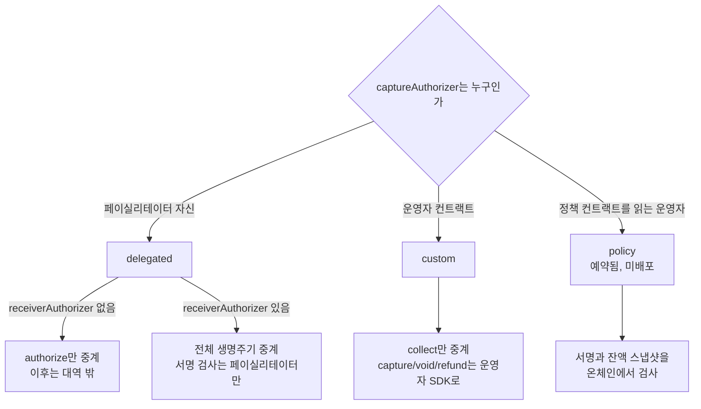
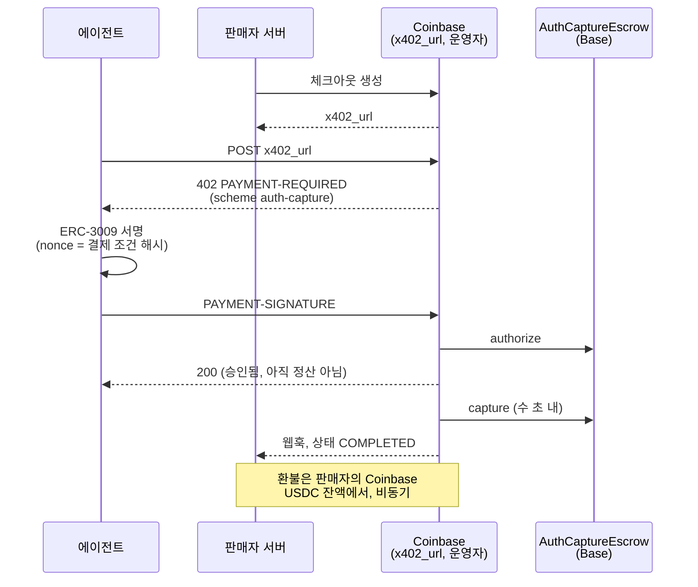

## 초록

x402는 2025년 백서에서 "차지백 없음, 사기 위험 없음"을 장점으로 내세운 비가역 결제 프로토콜로 출발했다[^s01]. 사람을 대신해 물건을 사는 에이전트 커머스에는 그 성질이 맞지 않는다. 그래서 x402는 Coinbase·Shopify의 Commerce Payments Protocol(CPP) 에스크로 위에 `auth-capture` 스킴을 얹어 되돌림을 들여왔다[^s02][^s22]. 이 보고서는 두 저장소의 코드와 공식 문서, 그리고 Base 메인넷의 7일치 이벤트를 직접 확인했다. 아래층 CPP는 감사 6건을 받았다. v1.1.0 테스트 115개가 로컬에서 모두 통과했고, x402 Go SDK가 계산한 서명 nonce는 메인넷 에스크로의 `getHash` 결과와 바이트 단위로 같았다[^s04]. 위층 스펙은 한 달 사이 v1.1로 커졌다. 결제 흐름 두 가지와 운영자 유형 두 가지(셋째는 예약)를 갖추었고, 스펙 스스로 페이실리테이터를 운영자로 쓰는 기본 경로의 보호를 "증명이 아닌 신뢰"라고 적는다[^s03]. 서버·페이실리테이터 SDK는 10월 초 병합됐지만 10월 23일 현재 어떤 릴리스에도 들어 있지 않고, 공개 페이실리테이터 세 곳도 이 스킴을 광고하지 않는다[^s08][^s09][^s10][^s13]. 정작 실사용은 다른 곳에 있다. Coinbase Business 체크아웃은 에이전트 결제에 auth-capture를 쓰고 Coinbase가 수 초 안에 캡처한다[^s14][^s15]. 온체인에서는 v1.0 에스크로에서 일주일에 약 170만 USDC가 움직였고, 그중 89%를 운영자 하나가 처리했으며 승인에서 캡처까지 중앙값은 4초였다[^s24]. 에스크로는 지금 배송 보증보다는 되돌릴 수 있는 즉시 결제로 쓰이고 있다. ACP와 AP2가 환불과 분쟁을 PSP나 감사 기록에 맡기는 것과 달리, x402는 이 되돌림을 컨트랙트에 넣었다[^s17][^s19]. 그 차이가 에이전트 커머스에서 x402가 가질 수 있는 몫이다.

## 1. 서론

x402 백서는 2025년 5월 날짜로 x402가 "약 200ms에 정산되고" "차지백 기간이 없다"고 썼다. 장점 목록에는 "즉시 확정되는 거래: 차지백 없음, 사기 위험 없음, 중개자 없음"이 있고, 비교표의 차지백 위험 칸에는 "No - not reversible"이 적혀 있다[^s01]. API 호출 한 번에 몇 센트를 받는 판매자에게는 이것이 장점이다.

물건을 사는 에이전트에게는 사정이 다르다. 2026년 9월의 한 arXiv 논문은 x402의 "원자적이고 최종적인" 모델이 "계량 접근에는 맞지만 커머스에는 실패한다"고 지적했다. 사람을 대신한 구매는 금액이 크고 자주 취소되며, 배송 전까지 판매자의 돈이 되어서는 안 된다는 것이다[^s22]. x402 저장소의 `auth-capture` 스펙은 같은 문제를 이렇게 정의한다. `exact`는 "고정 금액을 한 번 옮기고 돌려줄 방법이 없지만", `auth-capture`는 "승인 시점에 최종 금액을 모르거나 나중에 되돌려야 할 수도 있는 결제"를 위한 것이다[^s02].

이 사이트는 2026년 9월 22일 [같은 두 저장소를 다룬 보고서](../x402-auth-capture-commerce-payments/)를 냈다. 그때 x402 쪽은 클라이언트만 있었고 공식 문서에는 스킴이 없었다. 이 보고서는 그 뒤 한 달의 변화를 따라가면서 세 가지를 직접 확인한다. 하나는 컨트랙트와 SDK가 실제로 맞물리는지이고, 다른 하나는 무엇이 출하됐는지다. 마지막은 체인 위에서 이 에스크로가 실제로 어떻게 쓰이는지다.

## 2. 아래층: Commerce Payments Protocol

### 2.1 운영자를 믿지 않아도 되도록

CPP는 2025년 6월 12일 Coinbase와 Shopify가 함께 발표했다. 전통 결제의 "승인 후 캡처" 2단계, 즉 "먼저 구매자 자금을 잠그고(authorize) 나중에 판매자에게 지급하는(capture)" 흐름을 온체인으로 옮긴 것이다. 그 사이에서 자금을 움직이는 주체로 "운영자(operator)"라는 새 역할을 두었다[^s06]. Shopify는 동기를 분할 배송에서 찾는다. "여러 번에 걸쳐 배송하는 판매자를 위해 캡처를 여러 번에 나눠 할 수 있어야 한다"[^s07].

설계 문서가 운영자에 대해 약속하는 것과 약속하지 않는 것은 분명히 나뉜다. 운영자는 "프로토콜에서 자금을 훔칠 수 없다". 그러나 "결제를 진행시키지 않거나 조기에 void해서 검열할 수 있고", 최악의 경우 "`maxFeeBps`까지의 수수료를 자기가 고른 주소로 빼낼 수 있다"[^s05]. 에스크로 자금은 한 컨트랙트에 쌓이지 않는다. 운영자 주소에서 결정론적으로 파생된 운영자별 `TokenStore`에 나뉘어 보관되므로, 에스크로에 버그가 있더라도 다른 운영자의 유동성까지 번지는 것을 막는다[^s05]. USDC 거부목록(denylist)에 오른 수취인이나 수수료 수취인 때문에 캡처가 영영 막힐 수 있다는 점도 설계 문서가 스스로 인정한다[^s05].

### 2.2 감사와 재현

지난 보고서는 감사 건수를 5건과 6건 사이에서 정하지 못했다. 저장소 README의 감사 표와 `audits/` 디렉터리의 파일은 모두 6건이다. Coinbase Protocol Security가 2025년 3~4월에 세 번, Spearbit이 2025년 4월에 두 번 했고, 마지막은 v1.1.0의 반올림·과금 변경에 대한 Spearbit 감사(2026-07-22)다[^s04].

v1.1.0 커밋(`b748fdd`)에서 `forge test`를 돌리면 113개 중 112개가 통과한다. 실패한 하나는 Base 포크용 RPC 환경변수가 없어서 생긴 것이다. 공개 RPC를 지정해 다시 돌리자 Coinbase Smart Wallet의 ERC-3009, spend permission, EOA 경로를 다루는 포크 테스트 3개가 모두 통과했다[^s04]. 테스트 통과가 결함이 없다는 뜻은 아니며, 이 확인의 범위는 저장소가 스스로 정한 검사까지다.

### 2.3 SDK와 컨트랙트는 같은 해시를 계산하는가

auth-capture의 핵심은 클라이언트의 ERC-3009 서명 nonce에 결제 조건 전체의 해시를 넣는 것이다. 스펙은 이 값을 `keccak256(abi.encode(chainId, 에스크로 주소, payer를 0으로 둔 PaymentInfo 해시))`로 정의한다[^s03]. 이것은 에스크로의 `getHash`에 payer 0을 넣은 값과 같은 식이다. 그래서 고정 예제 하나로 세 경로를 대조했다. x402 Go SDK의 `ComputePayerAgnosticPaymentInfoHash`, 메인넷 v1.1 에스크로에 대한 `getHash` 호출, 그리고 `cast`로 스펙 공식을 직접 계산한 salt 바인딩이다. 세 값은 모두 일치했다. 실제 payer를 넣은 `paymentInfoHash`도 SDK와 온체인이 같았다[^s03][^s04]. 서명 하나가 운영자·수취인·만료·수수료 범위·salt까지 묶는다는 설계 주장이 적어도 이 구현 쌍에서는 실제로 성립한다.

## 3. 위층: auth-capture v1.1

### 3.1 흐름 두 가지와 마감 두 개

v1.1 일반 스펙은 결제 흐름을 `extra.paymentFlow`로 고르게 한다. 기본값인 `escrow`는 리소스 실행 전에 `authorize`로 자금을 묶고, 실행 뒤 `capture`나 `void`를 하며, `refund`는 그 뒤에 한다. `authorization`은 리소스를 실행한 다음 `charge`로 한 번에 정산하므로 hold가 없고 `capture`·`void`·`reclaim`도 없다[^s02]. 이후의 생명주기 연산은 새 엔드포인트 없이 `/settle` 페이로드의 `type`으로 구분한다[^s02]. EVM 바인딩은 여기에 `captureMode`(`sync` 또는 `deferred`)를 더하고 v1.0의 `autoCapture`를 없앴다. TypeScript SDK는 `autoCapture`가 들어오면 거부한다[^s03][^s08].

구매자 보호의 실체는 두 마감 시각이다. `captureDeadline`은 캡처가 가능한 마지막 순간이자 구매자의 `reclaim`이 열리는 순간이다. `refundDeadline`은 환불의 마지막 순간이다[^s02]. 서버가 결제를 방치해도 마감이 지나면 자금이 풀린다는 것이 스펙의 표현이다[^s02]. 거꾸로 말하면 그 전까지는 구매자가 혼자 꺼낼 길이 없다.

### 3.2 운영자 유형은 신뢰의 위치를 고르는 일이다

v1.1의 가장 큰 추가는 `extra.operatorType`이다. 에스크로가 `msg.sender`로 받아들이는 유일한 주소(`captureAuthorizer`, 온체인 `PaymentInfo.operator`)를 누가 쥐느냐에 따라 세 가지가 갈린다[^s03].

_그림 1 — auth-capture v1.1 EVM 바인딩의 운영자 유형. 위에서 아래로 갈수록 페이실리테이터에 대한 신뢰가 줄고, 프로토콜 밖으로 나가는 일이 늘어난다. policy는 스펙 부록에만 있다.[^s03]_

`delegated`에서 수신 측 승인자(`receiverAuthorizer`)를 두면 페이실리테이터가 capture·void·refund까지 중계한다. 스펙은 이때 서버가 잃는 것을 숨기지 않는다. "온체인에서는 아무것도 승인자 서명을 요구하지 않으므로 페이실리테이터 자신의 검증이 유일한 관문"이고, 클라이언트가 서명한 상한과 수수료 범위, 마감 후 `reclaim`의 테두리 안에서 그것은 "증명이 아닌 신뢰"다[^s03]. 수수료도 같다. delegated 서버가 실제로 노출되는 한도는 서명한 수수료와 무관하게 `maxFeeBps`이므로, 스펙은 고정 수수료(`minFeeBps == maxFeeBps`)를 권하고 범위를 공시하는 것은 "그 재량을 넘겨주는 것"이라고 적는다[^s03].

`custom`은 반대쪽 끝이다. 페이실리테이터는 collect 한 번만 중계하고, 그 뒤는 서버와 운영자 컨트랙트 사이의 일이다. 시간 잠금, 동결 기간, 중재 같은 규칙은 운영자가 마음대로 붙일 수 있지만, 페이실리테이터는 이를 중계하지도 검증하지도 않는다[^s03]. 대신 페이실리테이터는 검토하지 않은 코드로 중계하는 셈이다. 그래서 가스 상한을 직접 정해야 하고, 시뮬레이션이 되돌려지지 않았다는 것만으로는 부족하고, 정해진 이벤트·상태 전이·토큰 이동이 실제로 일어났는지까지 확인해야 한다[^s03].

`policy`는 둘 사이를 메우려는 셋째 유형이다. 운영자 컨트랙트가 승인자 서명과 잔액을 온체인에서 검사하고, 별도 정책 컨트랙트의 읽기 전용 훅으로 조건을 건다. 정책 주소가 salt에 들어가므로 구매자는 서명 시점에 어떤 규칙이 자기 돈을 다룰지 알 수 있다[^s03]. 다만 지금은 예약된 값이다. 부록의 Solidity는 "감사받거나 배포된 코드가 아니라 미래의 추가를 보여주는 예시"다[^s03].

### 3.3 nonce 없는 1회성, 그리고 환불 자금

capture와 refund는 반복할 수 있으므로 서버의 동의 서명이 재사용되면 안 된다. v1.1은 nonce 저장소를 두지 않는다. 대신 서명에 그 시점의 기대 잔액 `(capturableAmount, refundableAmount)` 쌍을 넣고, 페이실리테이터가 온체인 `paymentState`와 비교한다. 환불 뒤에는 두 잔액의 합이 줄고 다시 늘지 않으므로 같은 쌍이 반복되지 않는다. 스펙의 표현으로는 "결제 자신의 상태가 재사용 방지 키"다[^s03]. 다만 delegated에서는 이 비교가 페이실리테이터에서만 일어나서, 확인과 블록 포함 사이에 상태가 바뀔 수 있다. 스펙도 이를 "최선 노력"이라 부른다[^s03].

환불 자금은 구조적으로 어색한 자리다. 환불용 컬렉터는 `PaymentInfo.operator`에서 토큰을 끌어온다. delegated에서는 그 운영자가 페이실리테이터이므로 페이실리테이터가 돈의 출처가 된다. 그래서 스펙은 수취인과 별도 자금 계약이 없으면 delegated 환불을 거부하라고 요구한다[^s03]. 운영자와 승인자를 모두 페이실리테이터에 맡긴 결제는 `refundDeadline`까지 그 페이실리테이터에 "갇힌다"는 경고도 있다[^s03].

## 4. 무엇이 출하됐는가

### 4.1 코드는 있고 릴리스는 없다

Go 서버·페이실리테이터는 2026년 10월 5일(PR #3622), TypeScript v1.1 SDK는 10월 6일(PR #3203) main에 병합됐다[^s08][^s09]. 그러나 10월 23일 기준 npm의 `@x402/evm` 최신판은 9월 29일에 나온 2.28.0이고, 그 패키지에는 `auth-capture/client`만 들어 있다. 두 병합 커밋을 포함하는 릴리스 태그도 없다. Go 변경 기록도 아직 `unreleased` 폴더에 있다[^s09][^s10]. 저장소에서 빌드한 Go auth-capture 패키지 네 개(루트, client, facilitator, server)의 테스트는 모두 통과했다. 코드는 동작하지만 정식 배포 경로에는 아직 실리지 않은 상태다.

공식 문서는 한발 앞서 있다. 스킴 개요는 이제 auth-capture를 "자금을 에스크로에 보관했다가 풀어주는 환불 가능 결제"라는 네 번째 스킴으로 소개하고, SDK 기능 표는 auth-capture를 TypeScript·Go 지원, Python 미지원으로 표시한다[^s11][^s12]. 이 표는 역할별로 나뉘어 있지 않다. 그래서 npm 사용자가 표만 보고 서버를 붙이려 하면 배포판에 그 코드가 없는 상황을 만나게 된다.

페이실리테이터 쪽도 비어 있다. 10월 23일 공개 `/supported`를 직접 조회해 보니 x402.org는 exact·upto·batch-settlement, PayAI는 exact·batch-settlement, x402.rs는 exact·upto만 광고했다. Coinbase CDP 페이실리테이터는 인증이 필요해 확인하지 못했다[^s13] _(unverified — single source)_.

### 4.2 Coinbase Business: 이미 돌아가는 auth-capture

오픈소스 경로가 비어 있는 동안 auth-capture를 실제로 쓰는 곳은 Coinbase 자신이다. Coinbase Business 체크아웃의 `x402_url`은 "EVM `auth-capture` 스킴을 광고"하고, `exact`만 아는 클라이언트는 결제할 수 없다. 결제는 Base에서 가스 없는 USDC 승인으로 이뤄지며, "Coinbase가 서버 쪽에서 캡처하고 정산한다"[^s14]. 판매자 서비스는 결제 서명을 직접 검증하지 않는다. 판단 근거는 웹훅과 체크아웃 상태 `COMPLETED`이고, "캡처와 웹훅 전달에는 몇 초가 걸린다"[^s15]. 환불 재원은 "판매자 자신의 Coinbase Business USDC 잔액"이다[^s15]. The Paypers는 2026년 7월 28일 이 기능을 판매자 쪽 추가 설정이 필요 없는 에이전트 결제로 보도했다[^s16].

_그림 2 — Coinbase Business 체크아웃의 에이전트 결제. 판매자는 서명을 보지 않고 웹훅만 받는다. 어떤 에스크로 배포와 운영자 유형을 쓰는지는 문서에 나오지 않는다.[^s14][^s15]_

### 4.3 체인 위에서는 어떻게 쓰이는가

Base 메인넷의 두 에스크로에서 2026년 10월 16일부터 23일까지 7일치(블록 52,669,988~52,972,388) 이벤트를 공개 RPC로 모두 받아 집계했다. 스크립트와 결과는 `working/verify/`에 있고, 운영자 주소는 A~G로 가렸다[^s24].

| 항목 | v1.0 에스크로 | v1.1 에스크로 |
|---|---|---|
| authorize / charge | 15,791 / 120 | 20 / 0 |
| 승인·청구 금액 | 1,633,946 + 62,081 USDC | 0.02 USDC |
| capture / void / refund | 15,646 / 73 / 39 | 16 / 4 / 0 |
| 지급인 / 수취인 / 운영자 | 2,663 / 376 / 4 | 각 운영자당 1명 / 1 / 3 |
| 토큰 컬렉터 | 전부 ERC-3009 | 전부 ERC-3009 |

_표 1 — 7일간 CPP 에스크로 이벤트(필자 측정)[^s24]_

몇 가지가 바로 보인다. 첫째, x402 스펙이 기본으로 삼는 v1.1 배포에는 사실상 시험 거래만 있다[^s03][^s24]. 운영 트래픽은 모두 v1.0에 있다. 이 트래픽이 x402를 거치는지는 알 수 없지만, 거친다면 이전이 간단하지 않다. 스펙상 x402 스킴 v1.0용으로 만든 클라이언트는 v1.1 에스크로로 수금하는 서버에 결제할 수 없기 때문이다[^s03].

둘째, 집중도가 높다. 운영자 A 하나가 결제의 89.2%(14,193건), 지급인 2,491명, 수취인 53곳을 처리했다. 이 운영자가 캡처한 결제 14,192건 중 14,191건이 승인 후 10초 안에 캡처됐고, 전체 중앙값은 4초(블록 두 개)였다[^s24]. 반면 이 운영자가 설정한 캡처 마감까지의 기간은 중앙값 364일이다. 자금이 실제로 묶이는 시간은 몇 초인데, 운영자가 멈췄을 때 구매자가 `reclaim`으로 직접 돈을 꺼내려면 1년 가까이 기다려야 한다.

셋째, 되돌림은 드물다. void는 15,449 USDC(승인액의 0.95%), 환불은 39건 640 USDC였다[^s24]. 수수료 상한은 86%가 100bps 고정(min=max)이었고 125bps 고정과 0이 뒤를 이었다. 스펙이 delegated 서버에 권하는 고정 수수료 방식이 실제로도 주류다[^s03][^s24].

운영자 C는 다르게 움직인다. 321건이 모두 서로 다른 수취인이었고, 금액 중앙값은 약 100 USDC, 캡처 마감은 6일이었다. 캡처된 178건 중 10초 안에 캡처된 것은 130건이었다[^s24]. 배송 뒤 캡처라는 원래의 승인-캡처 용법에 가까운 패턴이다. 다만 이 운영자들이 누구인지, 그리고 이 중 몇 건이 x402를 거쳤는지는 체인 데이터만으로 알 수 없다. 모든 결제가 같은 ERC-3009 컬렉터를 쓰기 때문이다. Coinbase Business의 "수 초 내 캡처" 서술과 운영자 A의 4초 패턴이 비슷해 보이는 것도 정황일 뿐이며, 이 보고서는 둘을 연결하지 않는다.

## 5. 에이전트 커머스 지형 안의 x402

에이전트 결제를 둘러싼 다른 두 표준은 되돌림을 프로토콜 밖에 둔다. Stripe·OpenAI·Meta의 Agentic Commerce Protocol(ACP)은 체크아웃, 장바구니, 위임 결제, 주문 웹훅을 정의한다[^s18]. 위임 결제 토큰은 "위임 결제의 최대 금액과 만료로 제한"되지만, "정산, 환불, 차지백, 컴플라이언스는 판매자와 그 PSP에 남는다"[^s17]. Google의 AP2는 체크아웃 mandate와 결제 mandate로 사용자의 허락을 서명된 증거로 남기고, 그 기록이 "분쟁 해결에 도움이 되는 부인 불가능한 감사 추적"이 된다고 말한다. x402는 예시 시나리오에서 결제 수단으로 등장한다[^s19]. A2A용 x402 확장은 v0.1 스펙이며, 흐름은 판매자가 "검증하고 온체인에서 정산하는" 데서 끝난다[^s20].

이 비교에서 x402 auth-capture의 자리는 분명해진다. ACP와 AP2는 누가 무엇을 허락했는지를 증명하고, 돈을 되돌리는 일은 카드망이나 PSP에 맡긴다. auth-capture는 그 되돌림 자체를 컨트랙트로 옮긴다. 상한, 수수료 범위, 마감, 구매자의 일방적 `reclaim`이 서명 하나에 묶인다[^s03][^s04]. 카드 결제에서 발급사가 쥐던 보호 장치를 스테이블코인 결제에서는 만료 시각과 운영자 선택이 맡는 셈이다. 그리고 4.3절의 관측은 그 보호의 실제 강도를 정하는 것이 운영자 설정(364일 마감, 4초 캡처)이라는 것을 보여 준다.

수요는 아직 의문이다. CoinDesk는 2026년 3월 Artemis 분석을 인용해 x402 거래가 하루 약 13만 1천 건, 약 2만 8천 달러 규모이고 "약 절반이 인위적 활동"으로 보인다고 보도했다[^s21] _(unverified — single source)_. 같은 시기 x402 전체의 하루 거래액과 비교하면, 이번 주 CPP v1.0 에스크로의 하루 평균 약 24만 USDC[^s24]는 작지 않다. 그러나 그 결제가 x402에서 온 것인지 확인할 수 없으므로 두 수치를 이어 해석하지는 않는다.

검증 단계를 커머스에 붙이려는 시도도 있었다. auth-capture 위에 "검증 통과 시 capture, 실패 시 void" 규칙을 얹자는 PR #3066은 닫혔다. 리뷰는 "검증과 정산을 한 엔진에 합치면 판매자 측 지정인이 자기 일을 스스로 검증할 수 있게 된다"는 이해충돌을 지적했다[^s23]. v1.1이 예약한 `policy` 유형은 이 문제에 대한 스펙 쪽의 답으로 읽힌다. 조건을 판단하는 정책 컨트랙트를 서명 시점에 고정하고, 그 정책을 운영자가 아닌 온체인 훅이 집행하는 방식이다[^s03].

## 6. 논의

**기본 경로가 가장 신뢰를 많이 요구한다.** 페이실리테이터를 운영자로 쓰는 `delegated`는 operatorType의 기본값이다. 생명주기 전체를 페이실리테이터가 중계하는 가장 편한 경로이기도 하다. 그리고 스펙 스스로 이 경로의 보호를 "증명이 아닌 신뢰"라고 쓴다[^s03]. 신뢰가 필요 없는 `policy`는 아직 예약 상태다. 에이전트가 자율적으로 서명하는 환경이라면, 서버 운영자는 수수료를 고정으로 공시하고 마감 값을 정책으로 정해 두는 것이 스펙이 남겨 둔 유일한 방어선이다.

**마감 시각이 구매자 보호의 실제 크기다.** 컨트랙트는 마감 후 `reclaim`을 보장하지만 마감을 얼마로 둘지는 운영자가 정한다. 관측된 최대 운영자는 364일을 썼다[^s24]. 자금이 4초 만에 캡처되는 한 이 값은 거의 드러나지 않는다. 운영자가 멈추거나 수취인이 USDC 거부목록에 오르면[^s05], 구매자가 혼자 꺼낼 수 있는 시점은 1년 뒤가 된다. 에이전트에게 결제를 맡기는 사용자라면 서명 전에 이 값을 보여 주는 지갑 UX가 필요하다.

**환불은 여전히 누군가의 잔액에서 나온다.** 프로토콜 수준에서 환불 컬렉터는 운영자에게서 돈을 끌어온다[^s03]. Coinbase Business는 판매자 잔액을 쓴다[^s15]. 그렇다면 auth-capture가 카드망과 실제로 다른 점은 capture 이전 구간, 즉 void와 reclaim에 있다. 관측 주간에는 그 구간이 대부분 4초였다[^s24].

**채택의 병목은 스펙이 아니라 배포다.** 스펙, 문서, 코드, 테스트는 모두 있다. 빠진 것은 npm·Go 릴리스, 공개 페이실리테이터의 광고, 그리고 v1.0에서 v1.1로의 이전이다[^s10][^s13][^s24]. 이 셋이 채워지기 전까지 오픈소스 x402로 커머스 결제를 받는 길은 main 브랜치를 직접 빌드하거나 CPP를 직접 호출하는 것뿐이다. 그 사이 Coinbase Business처럼 운영자를 겸하는 사업자가 실사용을 먼저 가져가고 있다.

## 7. 한계

- 온체인 측정은 7일 한 주이며, 운영자 주소가 어느 회사인지는 공개 1차 자료로 확인하지 못해 익명으로 다뤘다. x402 경유분은 구분할 수 없다.
- Coinbase Business가 어느 에스크로 배포와 어떤 operatorType을 쓰는지는 공개 문서에 없고, 계정 없이는 `x402_url`을 받을 수 없어 직접 확인하지 못했다.
- CDP 페이실리테이터의 `/supported`는 인증이 필요해 조회하지 못했다. 공개 페이실리테이터 확인은 세 곳에 대한 한 시점의 조회다.
- 테스트 통과와 해시 일치는 저장소의 테스트와 고정 예제 하나에 대한 확인이며, 컨트랙트 전체 감사나 SDK 전체 검증이 아니다. TypeScript SDK는 대조하지 않았다.
- auth-capture v1.1은 변경 기록이 "proposed spec"이라 부르는 단계에 있어 필드와 오류 코드가 바뀔 수 있다[^s08]. policy 유형은 설계만 있다.
- x402 전체 수요와 인위적 거래 비율은 CoinDesk(Artemis) 단일 보도에 의존한다. AP2·A2A 확장은 공개 페이지와 README 수준까지만 확인했다.
- Coinbase Business의 출시 날짜는 보도마다 7월 23일, 7월 28일, 8월 11일로 다르다. 본문은 확인한 The Paypers 기사(7월 28일)만 인용했다.
